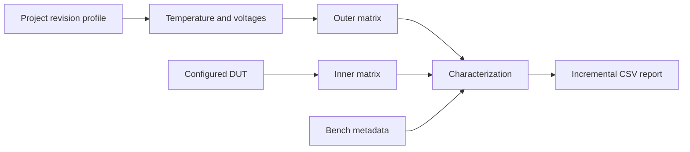

# Characterization

Characterization combines one persisted project revision profile with callback-
backed conditions, an outer operating-condition matrix, a test-specific inner
matrix, and an incremental CSV report.



The executable progression is under `examples/characterization`. This guide
explains the contracts; the [examples guide](examples.md) gives the runnable
module order.

## Select the revision profile

A project stores one `ProjectRevisionSpecifications` object for every supported
die, metal, and package revision tuple. Resolve the configured project and DUT
through the bench, then select the exact profile:

```python
project = bench.projects.characterization
dut = bench.duts.characterized_ic
specifications = project.specifications_for(dut.dut)
```

Each profile has at least one named voltage specification and one named
temperature specification. `Limits` distinguishes the recommended range used
for setpoints from optional absolute bounds:

```python
from elims_instruments.utils import Limits

limits = Limits(
    absolute_minimum=-55,
    minimum=-40,
    typical=25,
    maximum=125,
    absolute_maximum=150,
)

limits.validate(85)  # recommended range
limits.validate_absolute(140)  # absolute range
```

Bounds are inclusive and may be open. Values must be finite non-Boolean integers
or floats.

## Adapt hardware with callbacks

`Temperature`, `FixedVoltage`, and `AdjustableVoltage` describe capabilities
through callbacks. Their constructors do not communicate with hardware.

```python
from elims_instruments.characterization import AdjustableVoltage, Temperature

temperature = Temperature(
    temperature_specification,
    temperature_getter=chamber.measure_temperature,
    temperature_setter=chamber.set_temperature,
    enable=chamber.enable,
    disable=chamber.disable,
)

vdda = AdjustableVoltage(
    voltage_specification,
    voltage_getter=supply.measure_voltage,
    current_getter=supply.measure_current,
    voltage_setter=supply.set_voltage,
    current_limit_setter=supply.set_current_limit,
    enable=supply.enable,
    disable=supply.disable,
)
```

Enable and disable callbacks must be provided together. Missing optional
capabilities raise `NotImplementedError` when invoked. Setpoints are checked
against recommended limits; constructing a source stores its typical value but
does not apply it.

Voltage names normalize to lowercase underscore identifiers. A `Voltages`
collection assigns a distinct power order to every rail:

```python
from elims_instruments.characterization import Voltages

voltages = Voltages(
    [
        (10, vddd),
        (20, vdda),
    ]
)
```

Switchable rails power up in ascending order and power down in reverse. Fixed
rails remain in sequencing and reports but do not appear in adjustable
setpoints.

## Define outer operating points

Subclass `VoltageSetPoints` as a frozen dataclass. Field names must match
adjustable voltage names:

```python
from dataclasses import dataclass

from elims_instruments.characterization import OuterMatrix, VoltageSetPoints


@dataclass(frozen=True, slots=True)
class SupplySetPoints(VoltageSetPoints):
    vdda: int | float


outer_matrix = OuterMatrix(
    test_id="com",
    temperature=temperature,
    temperature_setpoints=[-40, 25],
    voltages=voltages,
    voltage_setpoints=[
        SupplySetPoints(vdda=1.1),
        SupplySetPoints(vdda=1.3),
    ],
)
```

The matrix yields the Cartesian product of temperature and voltage points.
Iteration is side-effect free. Before a point is applied, every voltage setpoint
is validated; values are then written in dataclass field order. Power enable and
disable order comes from `Voltages`, independently of that field order.

Use `temperature=None` with `None` temperature setpoints when a test has no
controlled temperature. Reports still reserve `t_target` and `t_actual` columns
with empty values, keeping schemas compatible.

## Define inner test points

An inner matrix supplies the configured DUT and one-based iterations to
test-specific sweep objects. A sweep resets the DUT, describes its report
columns, and returns its complete test ID with its measurement values. In this
example uses the bundled `ExampleDut`; replace the simulated calculation in
`run()` with a project-specific driver call:

```python
from collections.abc import Iterator, Sequence
from dataclasses import dataclass

from elims_instruments.characterization import InnerMatrix, InnerSweep
from examples.bench_setup.dut import ExampleDut


class FrequencyMatrix(InnerMatrix[ExampleDut]):
    def __init__(self, dut: ExampleDut, iterations: int) -> None:
        super().__init__("com-clock", dut, iterations)

    def __iter__(self) -> Iterator["FrequencySweep"]:
        for iteration in self.iterations:
            yield FrequencySweep(self.test_id, self.dut, iteration, 1_000_000)


@dataclass(frozen=True, slots=True)
class FrequencySweep(InnerSweep[ExampleDut]):
    frequency_hz: int

    def report_header(self) -> list[str]:
        return ["iteration", "frequency_hz"]

    def report_value(self) -> list[str]:
        return [str(self.iteration), str(self.frequency_hz)]

    def get_test_id(self) -> str:
        return f"{self.test_id}-{self.frequency_hz}-{self.iteration}"

    def run(self) -> tuple[str, Sequence[str]]:
        result = self.frequency_hz / 1_000_000  # simulated measurement
        return self.get_test_id(), [str(result)]
```

`InnerMatrix` rejects empty IDs and iteration counts below one. The concrete
DUT type is retained by the generic API, so each sweep can call project-specific
methods directly.

## Run the complete matrix

`Characterization` assembles the schema before changing hardware, then appends
one row after every completed inner point:

```python
from pathlib import Path

from elims_instruments.characterization import Characterization
from elims_instruments.utils.files import FileHelper


runner = Characterization(
    file_helper=FileHelper(
        Path("reports"),
        "characterization",
        FileHelper.FileSuffix.CSV,
    ),
    bench=bench,
    outer_matrix=outer_matrix,
    inner_matrix=FrequencyMatrix(dut, iterations=2),
    measurement_headers=["frequency_result"],
)
report_path = runner.run()
```

The outer and inner matrices must each yield at least one point. The number of
values returned by every inner sweep must match `measurement_headers`.

## Lifecycle and failure behavior

For each outer point, the coordinator performs:

1. validate that temperature and voltage report values are readable;
2. set the temperature and enable it when it is switchable;
3. validate and apply adjustable voltage setpoints;
4. power up switchable rails in order;
5. reset the DUT and run every inner point;
6. power down rails in reverse order;
7. disable the temperature source.

Cleanup is attempted after setup or measurement failures. If both the operation
and cleanup fail, Python raises an exception group that retains every error.
Failed voltage power-up also rolls back every rail whose enable operation was
attempted.

No data row is written for an incomplete inner measurement. The header and all
previously completed rows remain on disk for diagnosis. See
[Reports and analysis](reports.md) for the exact CSV contract.
